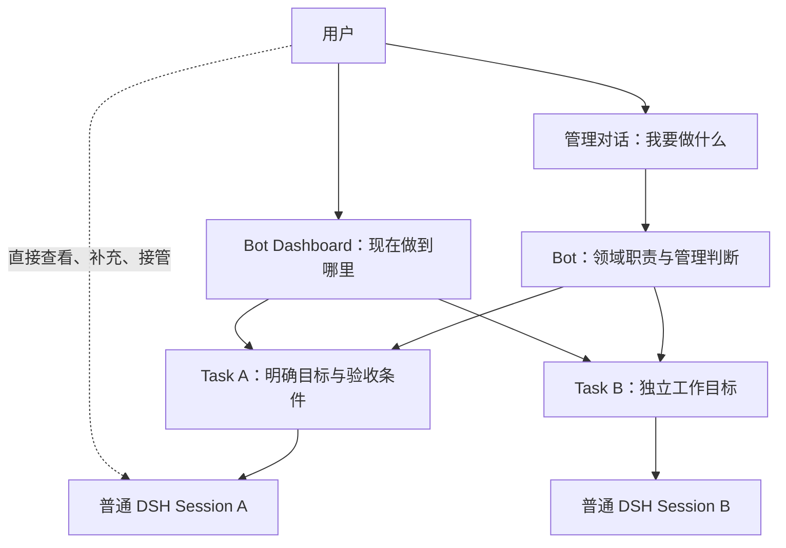
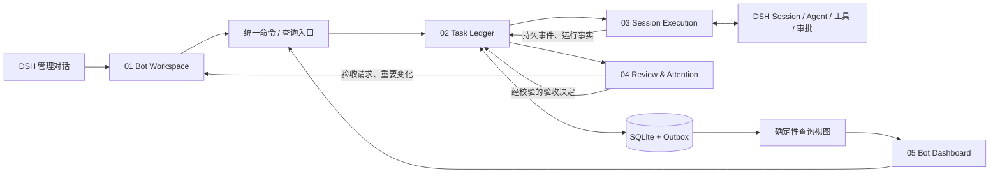
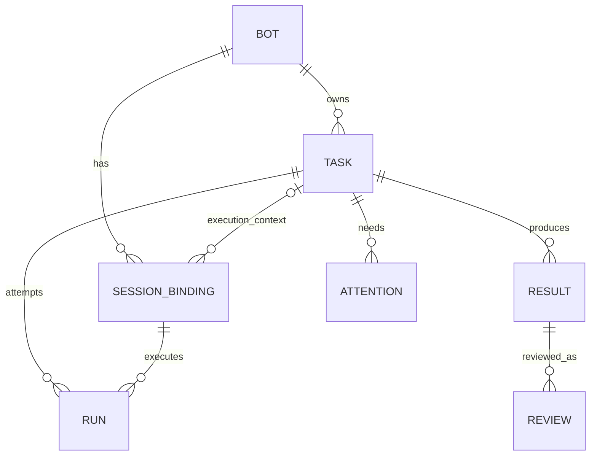
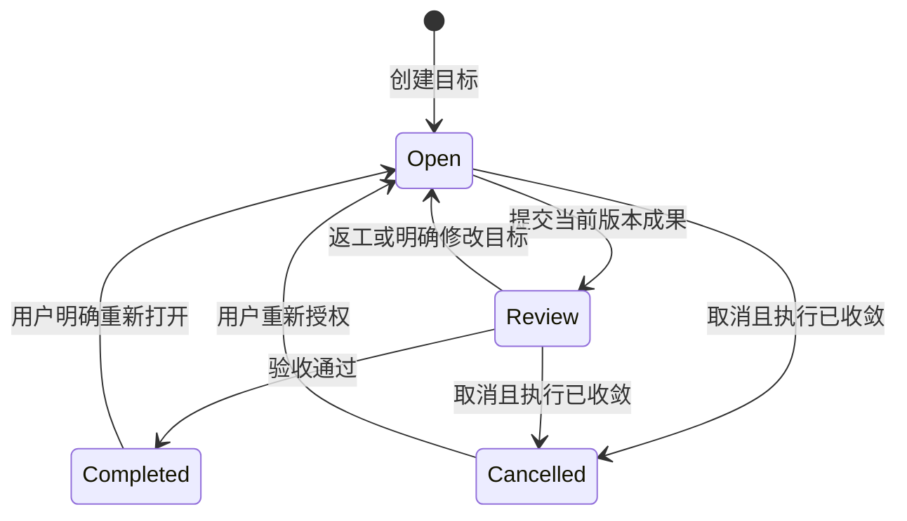
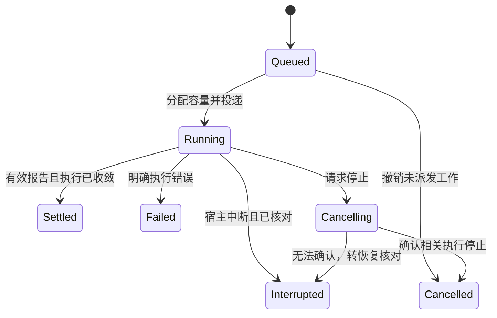
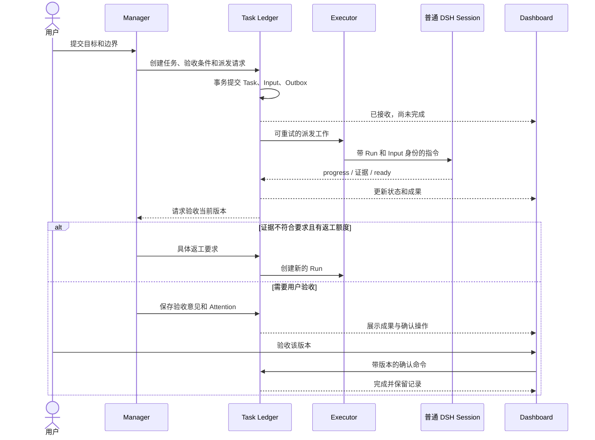
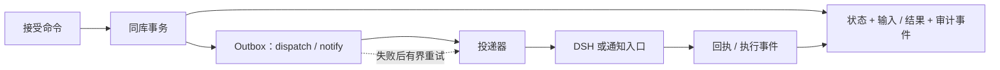

> 来源：用户于 2026-11-07 提供的设计 v0.1，冻结作为需求输入。产品现名 **Super Bot**，独立仓库 `super-bot`，DSH 仅为首个载体。实施顺序与补充约束以[当前提案](../specs/changes/2026-11-super-bot-mvp/README.md)为准。原笔记的相对链接在此快照中保留名称并转为纯文本，避免跨库失效；外部来源链接保持不变。

# DSH Bot Workspace：方案与设计 v0.1

> **定位：以 Bot 为入口，以 Task 为责任对象，以普通 DSH Session 为执行载体，以 Dashboard 为监督入口。**
>
> 本文是待实现的项目设计基线，不是现有产品能力或已通过的运行验证。采用单用户、单 DSH 宿主的最小部署；按业务模块划分 Specs，不按源码文件划分。

返回专题（原笔记引用） · 通用团队 Agent 蓝图（原笔记引用） · SuperAgent 研究（原笔记引用）

## 1. 要做什么

用户拥有几个职责明确、长期存在的 Bot。每个 Bot 能接收目标、管理多个普通任务 Session、检查成果、要求返工，并在确需输入时找人。用户既能和 Bot 对话，也能在面板看到全部工作、直接打开任务 Session。

**聊天表达意图；面板展示事实；程序维护状态；模型负责判断。**



### 首版边界

| 首版必须有 | 明确后置 |
| --- | --- |
| 多 Bot 基础身份，每 Bot 一个管理入口和面板 | Bot 群聊、Bot-to-Bot 协商、Chief 管所有 Bot |
| 创建任务 Session；经用户确认关联已有 Session | 多执行引擎、跨机器迁移、云电脑 |
| 任务状态、结构化报告、成果引用、有限返工 | 通用工作流引擎、任意 DAG、自动项目排期 |
| 信息补充、审批入口、成果验收、人工接管 | 完整 GitHub/飞书 Source、Thread Subscription、Routine |
| 持久任务、去重、失败说明、重启核对 | 自动学习记忆、独立 AI Watchdog、微服务 |

普通问答不强制创建 Task。需要独立执行、持续等待、验收或后续跟进时，才创建任务。首版开发先跑通一个 Bot，但数据和页面按多 Bot 设计。

## 2. 从哪些项目吸收什么

| 来源 | 吸收 | 不照搬 |
| --- | --- | --- |
| **DS-Bot** | 长期身份、DSH 插件集成、普通 Session 创建与关联的实现经验。[R1] | Bot 群聊体系、自定义整个聊天壳、复杂外观 |
| **SuperAgent** | 任务独立于 Session；执行分派与报告；持久输入；需要人处理的事项优先展示。[R2][R3] | 纯接单 Router 定位、完整外部事件和授权策略系统 |
| **Grok Bot** | 领域管理者管理执行 Agent、检查产物与证据、发起返工；把工作索引放在长聊天之外。[R4] | 云电脑、全套跨应用产品；不把官方使用案例当内部实现保证 |
| **OpenMausBot / Hermes** | Bot 身份与多个工作对话分离，保留原生交互入口。[N2][N3] | 多引擎、跨机中继及全套 Memory 维护 |
| **Comma** | 任务连续性、执行结束与业务验收分离。[N4] | 完整持续执行平台和复杂工作流 |
| **Rakazo / OpenBot** | 资源占用、审批、执行与外部效果必须分别核对的设计提醒。[N5] | Computer Provider 平台、团队权限系统 |

这里最重要的组合是：**Grok 的管理者体验 + SuperAgent 的任务机制 + DS-Bot 的 DSH 集成。**

Grok 的官方工程指南使用外部工作索引，帮助管理者跨越长聊天的上下文限制。[R4] 本方案把这个索引内建为任务账本与 Dashboard，但不依赖模型定期重写数据库来维持状态。

**与前期方案相比的修正：** Dashboard 进入首版；Manager 不只是转发器，还负责有限验收；Bot 不绑定某个 Session 的永久存活；`turn/end` 不再作为任务完成信号；状态存储从整份 JSON 改为单机 SQLite。

## 3. 总体架构与状态所有权



五个模块在同一插件宿主中运行，不是五个服务。DSH Adapter 是执行模块内部边界；数据库、认证、迁移、日志属于共同基础设施。

| 内容 | 权威位置 | 不能拿什么替代 |
| --- | --- | --- |
| Bot 配置、任务目标、关联、控制状态、验收决定 | 插件任务账本 | 管理对话摘要、Bot 记忆 |
| 模型对话、工具活动、原生审批及执行历史 | DSH | 插件臆测的运行状态 |
| 产物、测试日志、截图 | 文件或原始系统；账本保存版本化引用 | Worker 的一句“已完成” |
| 面板状态与计数 | 上述事实的确定性投影 | LLM 临时生成的表格 |
| 长期规范与偏好 | 用户可编辑的 Bot 配置/显式知识 | 当前任务的实时状态 |

所有业务状态变更经过 Task Ledger。Manager、Worker 和 Dashboard 都不能直接改数据库。DSH 对执行事实负责，账本对工作责任负责，两者通过事件核对，不互相覆盖。

## 4. 领域模型：身份、任务、尝试与上下文分开



`SessionBinding` 只记录关联，不复制 DSH Session。管理 Session 的绑定不带 `taskId`；任务绑定带 `taskId`。历史绑定保留；每 Bot 最多一个当前管理绑定，每 Task 最多一个当前执行绑定。

| 对象 | 最小数据 | 约束 |
| --- | --- | --- |
| **Bot** | `id, name, instructions, configRevision, managerBindingId, knowledgeRefs, skillRefs` | 身份长期存在；管理 Session 可更换 |
| **Task** | `id, botId, goal, scope, acceptance, reviewPolicy, lifecycle, controlMode, taskRevision, rowVersion` | 一项可独立验收的目标；不等于一条消息 |
| **SessionBinding** | `id, botId, taskId?, sessionId, kind, generation, active, eventCursor` | 区分 manager/task；同一 Session 不能同时绑定两个未结束任务 |
| **Run** | `id, taskId, taskRevision, bindingId, generation, state, inputIds, turnRefs, error?` | 一次派发尝试，可跨多个 DSH turn；终态不复活 |
| **Result / Review** | `resultId, taskRevision, artifactRefs, evidenceRefs, sourceRunId`；验收者、决定与所审版本 | `ready` 是提交验收；模型验收不冒充人工接受 |
| **Attention** | `id, taskId, kind, requestRef, question, taskRevision, state, answerRef?` | 信息补充、原生审批、验收、恢复核对分别处理 |

还需持久保存 Input、Event、Outbox，属于可靠性记录，不增加用户概念。

**两种版本不能混用：** `taskRevision` 在目标/范围/验收条件变化时递增；`rowVersion` 用于普通更新的并发校验。重命名或记录进度不应使全部成果失效。

### 关联与上下文规则

新任务默认新建普通 DSH Root Session。关联已有 Session 必须由用户确认目标、可读取历史范围和自动管理权限；不自动接管其他 Bot 的会话，也不把历史所有消息都算成当前任务的输入。

一个任务首版只保留一个主要执行 Session；续接时可换绑新 Session，保留历史引用。重试默认复用原 Session 与工作目录。不同任务不自动共享完整对话。

Manager 每次获取任务摘要、当前待办和必要证据；完整记录按 ID 分页读取。管理对话重置后，从配置与账本恢复，而不是要求模型记住全部任务。显式知识先由用户维护，自动提炼记忆后置。[R5]

## 5. 状态模型：不把所有事情压成一个 completed

### 5.1 Task 负责业务生命周期



暂停、人工接管、等待输入、执行失败不是另一个任务生命周期。它们是控制模式、待办或运行事实。一次 Run 失败后，Task 可以保持 Open，等待修复；Completed 不等于成果已经发布、PR 已合并或通知已送达。

### 5.2 Run 负责一次执行尝试



Settled 表示这次尝试告一段落，可能报告等待，也可能交付成果；不表示 Task 已完成。重试或等待后续跑创建新 Run，不修改旧 Run 的结论。

审批暂停时可以继续保留同一 Run，不能再给同一 Session 派发第二个 Run。模型轮次结束但后台工具/子任务仍工作时，不得假报执行结束。只有确认相关执行已收敛才释放相应槽位或写锁；无法确认就保留“待核对”。DSH 的持久 Session 事件和实时 Agent 事件需要区分使用。[R7]

### 5.3 面板状态是投影，不是第三套状态机

默认按以下顺序选主标签，详情仍保留全部事实：

| 判断 | 主标签 / 下一步责任 |
| --- | --- |
| 正在停止或执行结果不确定 | 停止中 / 待核对 |
| Task 已结束 | 已完成 / 已取消 |
| 有未解决 Attention | 等你回答 / 等你审批 / 等你验收 |
| `controlMode=manual/paused` | 人工接管 / 暂停自动管理 |
| Task 处于 Review | 待 Bot 验收 |
| 有活跃或排队 Run | 工作中 / 排队 |
| 有明确等待条件 | 等外部事件 / 等资源 |
| 最近 Run 失败且未安排恢复 | 执行失败 |
| 其余 | 待安排 |

`lastActivityAt`、`lastProgressAt`、`lastSyncedAt` 分开记录。超过观察窗口只能标“长时间无新进展”，不能断言死锁。等待 CI 等外部状态必须显示来源；首版无相应连接器时，显示“待人工确认”，不得伪称正在监听。

## 6. 五个模块 Specs

### SPEC-01 — Bot Workspace

**职责：** 长期身份、管理对话、职责知识与管理决策。

Manager 可以澄清目标、制定验收条件、派发任务、读取关键证据、提出有限返工；不承担持续编码，不阻塞等待所有 Worker。复杂验证另建普通检查任务，不增加常驻 Reviewer Bot。

管理工具仅在 Manager Session 生效；优先提供任务查询、读取证据和调度工具，不默认开放任意写入 Shell。普通问答不产生 Task；从对话创建任务须保留原请求来源，面板创建任务则立即得到持久 ID。

每 Bot 的管理轮次串行，重要报告进入持久通知队列；普通 progress 不持续唤醒 Manager。配置更新版本化，不能静默扩大已有任务授权。关闭管理对话不暂停任务；删除 Bot 前必须处理未结束任务，禁止级联删除用户 Session。

**验收：** 两个 Bot 的任务与知识不串用；换一个管理 Session 后仍可列出全部任务并继续管理。

### SPEC-02 — Task Ledger

**职责：** 任务、输入、运行记录、关联、状态和结果版本的唯一业务写入口。

创建任务至少保存目标、范围、验收条件和验收方式。范围不清时先建立未调度任务并提出一个具体问题。用户有权限创建、修改、暂停、取消、重开；Manager 只能在授权范围内安排工作；Worker 只能报告自己的执行。

每个命令带请求 ID；重复请求返回同一结果。更新校验 `rowVersion`；Run/Result/Review 都绑定 `taskRevision`。旧结果可以留档，但不能完成新目标。任务正文变更后，旧执行需停止或核对再调度，不能在同一目录中暗中双跑。

**验收：** 相同输入不会产生两份任务；旧结果和重复回调不会覆盖当前状态；面板计数与列表一致。

### SPEC-03 — Session Execution

**职责：** DSH 适配、Session 绑定、投递、执行事件、容量与恢复。

统一封装创建/解析 Session、发送输入、观察事件、读取历史、取消执行、打开原生 Session。具体 API 签名和能力先按选定 DSH 版本验证，不在业务模块散落 `ctx` 调用。[R1][R7]

投递至少关联 `taskId + runId + inputId + bindingGeneration`，再关联实际 DSH 消息与 turn。不能把该 Session 的任何回复都当成本任务结果。区分已入队、已投递、已进入执行上下文；没有相应证据时不声称“Worker 已读”。

同一 Session 同时一个活跃 Run；不同任务可并行。全局和每 Bot 都有限额，人工恢复/回答优先于新任务；已运行的任务不因新输入被随意抢占。共享可写工作目录串行，或为任务建立独立 worktree。Worktree 不是安全沙箱。

执行中的排队（下一轮）或插话（下一步）不视为接管，由当前自动轮次继续消化。自动轮次结束后，尚未收敛的执行上若再开启一轮真人消息，才记录人工干预并暂停后续自动派发，且不取消用户自己的这一轮。恢复自动管理前核对最新要求；无法可靠识别原生人工输入时，只能以显式接管按钮为兼容降级，必须在 UI 标明。

**验收：** 并行任务结果不串线；普通 Session 可直接操作；中断后可解释每个 Run 的状态；未知停止结果不显示“已停止”。

### SPEC-04 — Review & Attention

**职责：** 结构化报告、证据验收、人工问题与低打扰通知。

Worker 报告使用 `progress / waiting / ready / blocked / failed`，同时提交摘要、证据引用和可选待办。报告是状态建议，程序校验身份、版本和执行关联后提交。漏报不能由“最后一句听起来像结束了”补成 ready。

ready 先保存候选成果；待当前 Run 的相关工具/子任务确认收敛后，才进入 Bot 验收。Manager 对照每项验收条件给出通过、返工或需要人判断的决定，并引用对应证据。证据不足不通过；默认最多两次自动返工，之后转人工待办。这个上限是本方案默认值，不是参考产品的保证。

首版默认由用户最终验收。用户可在任务创建时选择低风险任务由 Bot 验收关闭；记录 `reviewedBy` 与独立的 `humanAcceptedAt`，不混淆两者。发布、合并、外发等动作仍按实际 DSH 权限/审批处理，不因任务验收通过自动获准。

Attention 区分 `input / approval / review / recovery`。普通问题回答后经历已提交、已投递、已消费，再标已解决；原生审批引用 DSH 请求 ID，以 DSH 状态为准。旧问题、旧成果或失效审批必须拒绝提交。多人协作后置，但不能由模型自报用户身份。

普通进展只更新面板；新待办、成果可用、明确失败才发送重要通知。按事件 ID 去重，问题更新替代旧提醒，不按每次轮询反复催促。先做 Bot 内通知，不接外部 IM。

**验收：** 面板里的每条待办都有明确对象和可执行操作；回答回到正确任务；结果没有证据时不能被标为已验收。

### SPEC-05 — Bot Dashboard

**职责：** 让用户不翻长聊天，也能知道 Bot 正在负责什么、做到哪里、下一步需要谁。

每 Bot 一个页面：总览、任务、成果、设置；“打开管理对话”进入原生聊天。全局入口可以汇总所有 Bot 的人工待办，不新增一套状态系统。

面板直接查询账本和执行状态，命令直接调用业务接口，不转换成自然语言让模型决定。Manager 模型不可用但宿主在线时，查询、回答已知问题、请求停止仍应工作。宿主失联时保留最后快照并明确过期，不缓存等待重连后自动执行的危险按钮操作。

**验收：** 使用 100 个模拟任务，包括等待输入、审批、失败和暂停场景；全部待办可检索，分类与计数可核对，UI 不加载所有会话正文。

## 7. 用户工作流与监督面板

### 7.1 从目标到交付



多个独立任务可以并行；相互依赖的工作由 Manager 在已有成果可用后安排下一项，不引入通用 DAG 引擎。

### 7.2 面板示意

以下数字、任务均为设计示例，不是产品实测截图。

```text
开发 Bot                            [打开管理对话] [新任务]
职责：网站开发与维护                 宿主在线 · 刚刚同步

[总览] [任务] [成果] [设置]

需要你处理 · 3
──────────────────────────────────────────────────────
登录改造   需要回答   是否保留旧登录方式？          [回答]
依赖升级   需要审批   DSH 请求执行指定操作          [去审批]
报表重构   等你验收   测试通过，附改动与预览        [看成果]

工作中 2 · 排队 3 · 等待 4 · 待 Bot 验收 1 · 暂停/异常 2
──────────────────────────────────────────────────────
任务       当前状态       最近进展 / 原因              更新
搜索修复   工作中         已复现问题，正在补回归测试    2 分钟前
导出优化   待 Bot 验收    已提交修改和基准测试          5 分钟前
CI 跟进    待人工确认     尚未接入 CI 状态源            8 分钟前
缓存整理   待核对         连接中断，不能确认执行结果     10 分钟前

[搜索] [按状态筛选] [显示已结束]              [下一页]
```

任务详情只展开一层：**目标与验收条件 → 当前进展和等待原因 → 成果及证据 → 关键事件 → 打开原生 Session**。完整工具轨迹留在 DSH。

每行至少回答五件事：是什么、目前什么状态、有什么新进展、下一步谁处理、信息何时更新。进度文字标明 Worker 自报、Manager 判断或工具证据；有可计数里程碑才显示进度比例，不由模型编造百分比。

Attention 默认按风险/等待时长等明确规则排序，不让模型凭印象替用户排全部优先级。人工待办计数按 Attention，任务计数按 Task；一个任务有两个待办时不能混算。

首版采用同源查询接口、按需详情和轻量定时刷新：只在页面可见时刷新，带版本号，失败退避；后台执行不依赖页面打开。以后需要流式更新再增加事件推送。

### 7.3 操作语义

| 操作 | 真正含义 |
| --- | --- |
| 打开 Session | 查看，不改变任务控制权 |
| 接管 / 原生人工输入 | 禁止 Manager 后续自动派发；不等于当前工具立即停止 |
| 暂停自动管理 | 不发新指令，当前 Run 可完成；状态持久化 |
| 停止本次执行 | 请求取消当前 Run，等执行器确认；Task 不自动取消 |
| 取消任务 | 禁止新工作并停止相关执行；未确认时显示“停止中/待核对” |
| 重试 | 修复原因或授权确认后创建新 Run，保留旧记录 |
| 恢复自动管理 | 核对最新人工输入、范围和待办，再允许调度 |
| 隐藏 / 归档 | 只整理视图，不代表停止；未结束任务首版不允许归档 |
| 解除 Session 关联 | 先收敛活跃执行，再移除当前绑定；保留任务历史和原会话 |

## 8. 最小接口与模型契约

以下是插件拟定的业务契约，不是已经验证的 DSH API 名称。

| 调用者 | 命令 / 查询 | 主要校验 |
| --- | --- | --- |
| 用户 / Manager | `task.create`、`task.list`、`task.get`、`task.dispatch` | Bot 归属、来源授权、范围、验收条件、请求去重 |
| 用户 / Manager | `task.review`、`task.revise` | 证据与版本；扩大范围只能由用户确认 |
| 用户 | `session.attach`、`session.detach`、`task.control` | 关联授权、在途执行、控制权 |
| 用户 | `attention.respond`、`result.accept` | 待办仍有效、确切成果版本、原生审批状态 |
| Worker | `work.report`、`work.ask`、`work.read` | 由绑定上下文确定 Task/Run，不相信模型自填身份 |
| Dashboard | `bot.summary`、`task.list`、`task.detail` | 同一状态投影、分页、快照版本 |

命令统一携带 `requestId`，变更已有对象携带 `expectedRowVersion`；涉及目标和成果时另带 `taskRevision/resultId`。冲突返回可解释的拒绝，不静默覆盖。

```text
WorkerReport
  reportId / taskId / runId / taskRevision / bindingGeneration
  kind: progress | waiting | ready | blocked | failed
  summary / evidenceRefs / artifactRefs
  wait?: { reason, expectedEvent, sourceRef, checkAfter? }
  attention?: { kind, question, requestRef? }
```

Task/Run 身份由工具执行上下文绑定，字段用于记录与校验。`checkAfter` 是核对时间，不是任意外部事件监听承诺。报告先原子落账，再产生验收或通知事件。

Manager 的 Prompt 只解释职责、授权边界、验收方法和工具用法。去重、状态迁移、权限校验、停止、预算与版本检查由程序强制执行，不能只写在 Prompt 里。

## 9. 持久化、恢复与故障处理

### 9.1 一个数据库，两个事实来源

建议 TypeScript Host + DSH Client Panel + SQLite。表可从 `bots / tasks / bindings / runs / inputs / results / reviews / attentions / events / outbox` 起步；无需一对象一套服务。

数据库保存控制状态、必要输入和证据引用；完整聊天仍由 DSH 保存。小摘要可内联，大产物保存稳定文件引用/版本/哈希。SQLite 位于本地磁盘；单宿主写入，多窗口读取，不在共享网络文件上跑多个写入宿主。启动时独占控制目录，第二个宿主拒绝调度，不能仅靠 SQLite 可并发写就认为执行权唯一。

数据库唯一约束与事务共同保证：请求 ID、输入 ID、报告 ID 去重；相同请求 ID 携带不同内容时拒绝；同一 Task/Session 不存在两个未收敛的执行尝试。只有当前版本成果通过验收、没有阻塞待办且相关执行已收敛，才可提交 Completed；验收待办的解决与完成状态在同一事务中写入。



输入与可调度责任一起提交后才确认接收；结果、状态、待办及通知 Outbox 一起提交。文件先耐久写入，再发布引用。外部工具效果不在这个数据库事务中。

### 9.2 恢复规则

| 故障窗口 | 首版处理 |
| --- | --- |
| 接收后、派发前崩溃 | 从 dispatch Outbox 恢复同一输入，不新建任务 |
| DSH 已接收但回执丢失 | 按输入 ID 查询 Inbox/历史；确认存在则不重投；无法确认则转核对 |
| 插件重载但 DSH Agent 仍工作 | 重新订阅并关联原 Run，禁止盲目另起执行 |
| 宿主退出中断执行 | 核对历史、文件与已发生效果；旧 Run 标中断，明确恢复时创建新 Run |
| 旧 Run 迟到结果 | 保留审计，校验代数与任务版本；不得覆盖新状态 |
| 结果已提交但通知失败 | 只重试通知，不重新执行任务 |
| 请求停止但工具/子进程未确认退出 | 显示停止中或待核对；不释放冲突资源给新 Run |
| 文件/外部系统可能已变更但缺回执 | 标明结果不确定，先核验，不自动重复外部动作 |

短暂的、可确认未提交的通信失败可退避重试；权限、登录、预算和结果不确定不无限重试。具体次数与延迟写成可测试的配置默认值。

**保证边界：** 本方案保证账本内去重与拒绝过时提交，不声称任意外部动作恰好一次。执行重试、输入重投和通知重发是三种不同操作。[N1]

备份应覆盖插件数据库、引用产物与 DSH 数据；升级前备份并验证 schema 版本，迁移失败不继续派发。卸载插件撤销监听器和专属工具，不删除用户会话及成果。

## 10. 权限、资源与预算

首版信任边界是同一个可信本机用户；不同 Bot 不自动成为安全租户。Bot ID、Session、目录或 worktree 都不能证明 OS、网络和秘密隔离。[N1][N5]

| 约束 | 落实方式 |
| --- | --- |
| 任务授权 | 保存请求来源、范围、允许动作和验收方式；新上下文不等于新增授权 |
| DSH 权限 | 沿用实际工具和审批机制；Manager 不得自行提高执行权限 |
| 现有 Session 访问 | 用户确认关联及历史可读范围；禁止自动回退读取其他 Bot 的私有数据 |
| 资源冲突 | 同一可写目录串行或隔离工作树；有共享浏览器/服务时另设资源锁 |
| 有界执行 | 全局/每 Bot 并发上限；任务执行时间、模型用量和返工次数有上限 |
| 紧急控制 | 用户暂停/停止在调度入口检查；在途动作已发生的效果不能假装撤销 |

默认不自动发布、合并、删除重要数据或外发消息。高风险工具若无法通过 DSH 形成可靠审批边界，就不在首版开放该能力，不能用插件 UI 上的“批准”代替真实约束。[R6]

模型成本能精确归因时展示；否则展示 Token/运行次数及估算标记。后台执行需要 DSH 宿主在线；关闭 Panel 不影响宿主工作，关闭宿主不等于云端仍在执行。

## 11. 关键取舍（ADR）

| ID | 决策 | 原因与代价 |
| --- | --- | --- |
| D01 | 新建轻量 DSH 插件，提取行为而非整库 Fork | 保留原生执行与聊天；需自行实现任务和面板集成 |
| D02 | Manager 采用领域管理者，而非纯 Router | 能检查成果、要求返工；必须限制验收预算，避免成为执行瓶颈 |
| D03 | Task / Run / Session 分开，UI 只突出 Task | 支持恢复与验收；少量额外状态换取明确语义 |
| D04 | 每 Bot Dashboard 属于首版 | 长聊天无法承担监督；增加轻量前端，但不重写聊天壳 |
| D05 | SQLite + Outbox，替代整份 JSON | 多任务、待办与投递需要事务；增加迁移/备份工作 |
| D06 | 默认人工最终验收，可明确选择 Bot 验收 | 交付标准透明；不是所有 ready 都立即完成 |
| D07 | 原生 Session 保留，人工输入暂停后续自动派发 | 防止双重指挥；恢复管理需要一次明确动作 |
| D08 | 显式知识 + 引用，先不做自动记忆合成 | 减少污染和维护成本；经验积累初期由用户确认 |
| D09 | 事件驱动 + 程序核对，不做持续 LLM 轮询 | 更低费用、更少噪声；语义卡住先提示，不假称能自动诊断 |
| D10 | 外部 Source、订阅、Routine 后置 | 先验证 Bot→Task→Session 闭环；届时增加输入适配，不改任务核心 |

不复制 SuperAgent 的全部策略域，也不把其公开原型、内部实践和设计文章混为一体。Grok 只用官方产品文档与使用范式作参考，不依赖历史非官方重构推断当前服务端。[R2][R4][N6]

## 12. 实施顺序与验收

### 12.1 四个可验证阶段

| 阶段 | 交付物 | 退出条件 |
| --- | --- | --- |
| **P0 兼容验证** | 固定 DSH 版本；验证插件、Session、事件、工具作用域、审批和面板入口 | 明确哪些能力可支持、哪些需降级；没有虚构 API |
| **P1 观察闭环** | Bot、任务账本、Session 关联、只读 Dashboard | 可创建/关联任务，重启后身份和列表可恢复 |
| **P2 执行闭环** | 派发、报告、验收、待办回答、控制按钮、成果详情 | 一项任务从创建到验收跑通，可要求修改 |
| **P3 可靠性与多任务** | 去重、Outbox、容量、人工干预、故障恢复、多 Bot | 下表测试通过；再考虑外部事件和 Routine |

P1 面板先用真实/模拟状态建立可观察性，而不是把 UI 留到所有后台逻辑完成之后。

### 12.2 验收场景

| ID | 场景 | 必须成立 |
| --- | --- | --- |
| T01 | 一个 Bot 管理两个并行任务 | 身份、消息、结果不串线；用户可打开各自 Session |
| T02 | 管理会话压缩或更换 | Bot 和任务仍在，Manager 能从账本恢复概况 |
| T03 | 100 个模拟任务混合各种状态 | 不翻聊天可定位全部人工待办；计数、筛选、分页一致 |
| T04 | 重复创建、派发和报告 | 同一请求/输入/报告只改变一次账本，不重复产生责任 |
| T05 | Worker 报告 ready，但证据缺失 | 保持待验收或返工，不自动完成 |
| T06 | 用户改目标，旧 Run 随后返回 | 旧成果留档，不能完成新版本目标 |
| T07 | 面板回答问题、拒绝审批、验收成果 | 操作关联正确任务和版本；审批结果以 DSH 为准 |
| T08 | 原生 Session 人工输入与 Manager 调度竞争 | 在验证过的 DSH 顺序边界中暂停后续自动派发，不双重发令 |
| T09 | 长工具仍运行但模型 turn 结束 | 不显示任务已完成，不错误释放冲突资源 |
| T10 | 在输入提交、派发、报告、通知之间重启 | 任务不丢；无证据的投递不盲目重复；通知失败不重做业务 |
| T11 | 停止超时、工具效果未知 | 明确停止中/待核对，旧执行不能覆盖新状态 |
| T12 | 模型不可用或 Panel 离线重连 | 宿主在线时确定性操作仍可用；离线快照明确过期 |
| T13 | 两个 Bot 访问对方任务，或两个任务写同一目录 | 拒绝越权业务操作；冲突执行被串行或隔离 |
| T14 | 自动返工耗尽或 Worker 没有报告 | 转明确待办，不无限续跑、不伪造完成 |

这些是待执行测试，不代表当前实现已经通过。

### 12.3 开发前必须确认的 DSH 接口

Session 的稳定 ID 与恢复方式；输入元数据是否可持久回读；Agent 事件和 Session 日志的对应；原生用户输入的识别/顺序；后台作业与取消范围；审批请求查询/跳转；工具作用域与卸载；客户端面板和 Session 导航。

不能可靠取消时只提供“请求停止”；不能可靠识别人工输入时使用显式接管；不能聚合审批时跳转原生卡片；不能证明投递成功时进入恢复核对。降级必须写在面板与兼容表中。

### 12.4 如何从本文落到 Specs 和代码

本文作为方案总入口。建仓时拆出 `00-architecture` 与上述五份模块 Spec；每份只维护职责、契约、不变量和对应测试 ID，不逐文件复刻 DS-Bot。

```text
固定参考版本 → 提取可观察行为 → 选择首版范围
    → 写契约与验收测试 → 用 Fake DSH Adapter 测状态
    → 接真实 DSH 跑纵切 → 注入重启/重复/取消故障
```

实现仓库成为后续 API、schema、测试结果的权威；本笔记维护目标、架构和取舍，避免长期维护两套细节。

## 13. 参考与证据口径

**外部来源：** Grok 官方资料于 2026-11-07 查阅，属于产品文档/使用经验，不是独立性能或安全实测。SuperAgent 的关键参考固定到 `8c32a9dc5d72c033816c6a8110b37f40cf94fba4`。DS-Bot、DSH 的可变分支只作接口线索，P0 必须另行锁定兼容版本。

- **[R1] DS-Bot：** [项目与插件](https://github.com/Fei2411/DS-Bot)、[普通 Session 管理](https://github.com/Fei2411/DS-Bot/blob/main/ds-bot/src/host/agents.js)。该 DSH Agent 入口与 Bot 团队分开；不能将它描述为现成的“每 Bot 管任意任务 Session”。2026-11-07 读取的 `agents.js` blob 为 `0ab0cd55d318e1d2fbdec8b60b7c64b008f6643f`。
- **[R2] SuperAgent：** [领域模型](https://github.com/deepseek-ai/dsh-superagent-prototype/blob/8c32a9dc5d72c033816c6a8110b37f40cf94fba4/docs/001-domain.md)、[执行与恢复](https://github.com/deepseek-ai/dsh-superagent-prototype/blob/8c32a9dc5d72c033816c6a8110b37f40cf94fba4/docs/003-execution.md)、[角色规则](https://github.com/deepseek-ai/dsh-superagent-prototype/blob/8c32a9dc5d72c033816c6a8110b37f40cf94fba4/docs/004-prompts.md)。借鉴行为，不承诺整个原型已可生产部署。
- **[R3] SuperAgent Panel：** [设计说明](https://github.com/deepseek-ai/dsh-superagent-prototype/blob/8c32a9dc5d72c033816c6a8110b37f40cf94fba4/docs/005-panel.md)、[客户端入口](https://github.com/deepseek-ai/dsh-superagent-prototype/blob/8c32a9dc5d72c033816c6a8110b37f40cf94fba4/src/client/index.tsx)。参考人工待办优先和 DSH 内嵌面板，不复制全套页面。
- **[R4] Grok：** [工程 Bot 实践](https://x.ai/bot/guides/grok-bot-for-engineering)。重点是领域职责、管理执行 Agent、核对证据和长期工作索引，不采用其中的产能宣传数字作评测结论。
- **[R5] Grok：** [Bot 身份与职责](https://docs.x.ai/grok-bot/bots)、[文件与成果](https://docs.x.ai/grok-bot/files-and-results)。借鉴长期职责与可审阅交付，任务账本和确定性 Dashboard 是本方案的设计选择。
- **[R6] Grok：** [审批、安全和隐私](https://docs.x.ai/grok-bot/approvals-security-and-privacy)。借鉴具体操作与输入可见；我们的强制边界必须由实际 DSH 集成验证。
- **[R7] DSH：** [架构与事件](https://github.com/deepseek-ai/deepseek-harness/blob/master/docs/architecture.zh.md)、[插件打包](https://github.com/deepseek-ai/deepseek-harness/blob/master/docs/user/develop/basic/publish.md)。复用其运行时，不自行重写 Agent Loop。

**已有笔记：** 以下保留各自文档中的日期、固定提交和验证限制，不因本文更新而视为重新审计。

- **[N1]** 团队 Agent 蓝图（原笔记引用）、持续执行协议（原笔记引用）：状态所有权、输入交接、取消与未知效果。本文只定义本项目的最小选择。
- **[N2]** OpenMausBot（原笔记引用）：长期 Bot 与多个工作对话、共享资源竞争。
- **[N3]** Hermes（原笔记引用）：Bot 身份、固定管理会话与普通 Session 并存。
- **[N4]** Comma（原笔记引用）：Task-first、持续责任、结果与人工验收。
- **[N5]** Rakazo（原笔记引用）、OpenBot（原笔记引用）：执行资源、审批和实际隔离边界。
- **[N6]** Grok Bot（原笔记引用）、SuperAgent（原笔记引用）：产品定位和原型证据边界。

**完成标准：** 用户不需要记住长聊天，也不需要轮流询问几十个 Session，就能知道每个 Bot 正在负责什么、哪些成果可信、哪里需要自己处理，并能安全地继续、接管或停止工作。
