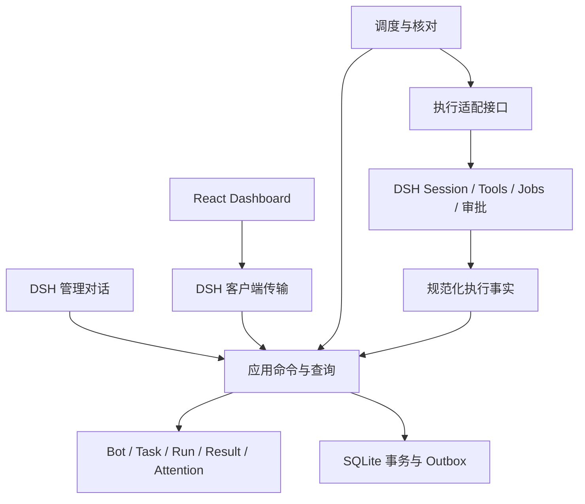

# 00 架构与共同约束

## 产品与载体

Super Bot 以长期 Bot 对话为主入口，在后台管理任务责任、执行、验收和监督。DSH 是首个执行后端和界面宿主。当前全体模块在同一插件宿主内运行，模块边界不等于服务或独立 npm 包。

2026-11-07 修订以 [聊天主流程](06-chat-first.md) 为产品体验准则：复用 DSH 原生聊天与当前任务底层，只调整入口、对话行为和必要工具。下面的架构与不变量继续适用，不为聊天入口增加第二套消息存储、事件总线或调度器。

初始只用一个包和少量文件：`src/model.ts`（纯类型/状态）、`src/store.ts`（事务与业务命令）、`src/dsh.ts`（执行适配）、`src/index.ts`（Host 装配）、`src/client.tsx`（Client 入口）、`src/ui/`（页面）。下表是职责边界，不要求每层一个目录/接口/Service；只有真实复杂度出现时再拆分。禁止为未来载体建立通用事件总线、插件式调度器或多后端注册中心。

| 层 | 拥有 | 不应依赖 |
| --- | --- | --- |
| domain | 业务对象、状态迁移、不变量 | DSH、Cordis、React、数据库驱动 |
| application | 命令、查询、调度、授权、事务编排 | DSH 事件格式、客户端组件 |
| storage | schema、迁移、事务、幂等和资源占用 | 模型推断 |
| adapters/dsh | Session ID 映射、事件、工具作用域、取消与审批事实 | 绕过应用服务直接写业务状态 |
| ui | 展示、命令表单、状态来源和新鲜度 | 宿主对话正文、直接数据库读写 |
| entrypoints/dsh | Host/Client 注册、连接和生命周期 | 新的业务状态机 |

执行引用最少保存 `{ backend: 'dsh', instanceId, sessionId }`；会话与运行引用是可序列化值，不能保存 Agent/Context 对象。未来增加后端时可扩展引用，但不自动迁移或接管旧 DSH 会话。SQLite 数据目录由宿主配置传入，独立于源码目录；控制目录独占，第二宿主拒绝调度。

## 边界契约

执行适配接口描述能力而不是伪造 SDK 名称：创建/解析 Session、绑定输入身份投递、分页读取事实、观察活动、请求停止、查询自有输入和相关执行、生成导航信息。能力查询必须返回支持/有限支持/不可用和原因，不仅一个 boolean。

事实至少区分：`input.enqueued`、`input.entered`、`input.discarded`、`execution.quiescent`、`execution.unknown`、`native.intervention`、`approval.changed`。保留原始事件引用、执行引用、绑定代数和读取游标；当前后端不支持的事实不合成成功。

宿主上下文生成 `Actor`（user / manager / worker / system）、Bot 归属与能力；模型字段不能设置 Actor。客户端身份由宿主连接认证得出。应用命令只信任服务端授权上下文。用户可跨自己的 Bot 操作，Manager/Worker 只能访问其范围。

## 必须从第一次执行就存在的不变量

1. 接收命令时同一事务提交状态、Input、Event、Outbox；相同幂等键同内容返回原结果，异内容拒绝。
2. `taskRevision` 表示目标/范围/验收版本；`rowVersion` 表示并发更新；进展更新不能替换目标版本。
3. Run 终态不可复活；同一任务和 Session 不得有两个未收敛尝试。Failed/Interrupted 但效果未知仍持有资源占用记录，不能靠 Run 是否终态决定可重试。
4. 进入 Completed 需要当前版本成果、有效 Review、验收授权、无阻塞待办、执行收敛，在一个事务内关闭验收 Attention。
5. 凡是跨进程、跨工具或对外效果，不声称恰好一次。重投输入、重跑执行、重发通知是三种不同动作。
6. 控制操作提交后立即阻止后续派发；已在运行的工具不能假装撤回。每次最终派发和应用 Manager 决策前重新验证控制模式及版本。

## 对原基线的细化

- 可靠性前移：Outbox、版本校验和资源占用在人工驱动纵切时完成，后期做故障验证。
- `ready` 是候选结果；同一 Run 存在后续人工输入或证据变化时必须重新核对，不让早先 ready 完成后续目标。
- Manager 调用异步返回后可能已经接管/暂停；拒绝其过时派发和验收，不因模型已思考完就执行。
- 无法限制“关联已有 Session”的模型历史读取范围时，不承诺部分历史隔离：只允许用户明确授权全历史关联，或在新 Session 中导入明确选中的材料。插件列表过滤无法限制 DSH 模型原有上下文。
- Session 创建也有响应丢失窗口。先持久化创建意图；若无法按稳定标识核对，不盲目再建，标记待恢复，避免幽灵会话。
- 首版证据引用保存稳定版本/哈希、来源 Run 和验证时间；路径不等于内容不可变。验收重读当前内容或使用持久快照；引用失效或哈希变化则不能通过。

## 技术决策与后续门槛

本机内存 SQLite 探针通过，暂优先评估 `node:sqlite`，驱动仅位于 storage。P0 还要验证真实插件进程中的 WAL、事务、迁移、备份与退出；不能仅凭 Node 版本就承诺支持。若需换驱动，在证据页记录原因，不改领域契约。

采用同源宿主传输及可见页面轻轮询；不新增公开 HTTP 监听。独立 App/Web 后续需要重新提供认证、连接、执行和生命周期，不属于当前 MVP。
